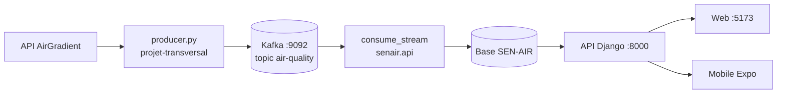

# SEN-AIR : Plateforme de surveillance de la qualité de l'air à Thiès

Système intelligent d'estimation et de prévision de la qualité de l'air (Master 1 ILIA, École Polytechnique de Thiès, 2025/2026).

Ce dépôt contient le **front** et le **backend** de la plateforme :

| Dossier | Rôle | Technologies |
|---|---|---|
| [senair.web](./senair.web) | portail citoyen responsive installable (PWA) + back-office autorités/administrateurs | React 19, Vite, TypeScript, React Router, TanStack Query, Leaflet, Recharts |
| [senair.mobile](./senair.mobile) | application citoyenne Android/iOS | Expo SDK 58, React Native, Expo Router |
| [packages/core](./packages/core) | socle partagé : règles métier, contrat API, client HTTP, validation, données de démonstration | TypeScript, zod |
| [senair.api](./senair.api) | API REST, comptes et MFA, alertes et push, back-office, lecture en streaming du pipeline Kafka, intégration des modèles IA | Django 6.1, DRF, PostgreSQL, Kafka |

Les dossiers `air_quality/` (Airflow, modèles), `projet-transversal/` (producer et consumer Kafka) et `Donnée/` appartiennent à l'équipe IA / data ; l'API lit leurs données en streaming ([docs/14](./docs/14-integration-donnees-ia.md)).

## Guide de lancement

Choisissez votre point de départ :

| Objectif | Ce qui tourne | Durée | Section |
|---|---|---|---|
| **Relancer le projet au quotidien** | API, web et mobile sur la base existante | 2 min | [3](#3-lancement-quotidien) |
| **Ouvrir l'application sur iPhone** | Expo Go, sur le même Wi-Fi | 5 min | [4](#4-lancer-sur-iphone) |
| **A. Démo rapide** | web et mobile avec des données simulées, sans backend | 5 min | [5](#5-parcours-a--démo-rapide-sans-backend) |
| **B. Plateforme complète en local** (première installation) | pipeline Kafka de l'équipe IA, backend Django, web et mobile branchés dessus | 20 min | [6](#6-parcours-b--plateforme-complète-en-local) |
| **C. Backend avec Docker** | PostgreSQL, API et consommateur Kafka dans des conteneurs | 10 min | [7](#7-parcours-c--backend-avec-docker) |



### 1. Prérequis

| Outil | Version | Vérifier | Nécessaire pour |
|---|---|---|---|
| Node.js | **≥ 22.13** (fichier `.nvmrc`), exigé par Expo SDK 58 | `node -v` | web, mobile |
| npm | ≥ 10 | `npm -v` | web, mobile |
| Python | **3.14** (3.13 convient) | `python3 --version` | backend, pipeline |
| Docker et Docker Compose | récents | `docker compose version` | Kafka du pipeline, parcours C |
| Expo Go (téléphone) | **SDK 58** (version 58.0.5 ou plus récente) | App Store / Play Store, avec un compte Expo gratuit | mobile sur téléphone |
| Application d'authentification | Google Authenticator, Aegis… | | connexion autorité / admin en mode réel (MFA) |
| Android Studio + émulateur | récent | `emulator -list-avds` | mobile sur émulateur (facultatif) |

Ports utilisés : **5173** (web), **8000** (API), **8081** (Expo), **9092** (Kafka), **8080** (Kafka UI), **9000-9001** (MinIO), **5433** (PostgreSQL du backend en Docker).

### 2. Installation (une seule fois)

```bash
# Depuis la racine du dépôt (le dossier SEN-AIR)

# Front : Node 22, puis un seul install à la racine (monorepo npm)
nvm install 22 && nvm use 22
npm install

# Backend : environnement Python
cd senair.api
python3 -m venv .venv
.venv/bin/pip install -r requirements-dev.txt -r requirements-ml.txt
cd ..
```

> Ne lancez pas `npm install` dans `senair.web/` ou `senair.mobile/` : cela crée des copies de React en double et casse le mobile. Pour ajouter une dépendance : `npm install <paquet> --workspace senair.web`, ou `cd senair.mobile && npx expo install <paquet>`.

Vérifier que tout est sain :

```bash
npm run check                                              # front : typecheck, tests, build
cd senair.api && .venv/bin/pytest && cd ..                 # backend
```

### 3. Lancement quotidien

Une fois l'installation faite et la base remplie ([parcours B](#6-parcours-b--plateforme-complète-en-local)), trois terminaux suffisent. **Chaque terminal part de la racine du dépôt** (le dossier `SEN-AIR`) : si vous êtes déjà dans `senair.mobile` ou `senair.api`, sautez le `cd`.

```bash
# Terminal 1 : API, accessible depuis le téléphone grâce à 0.0.0.0
cd senair.api
DJANGO_DEBUG=1 .venv/bin/python manage.py runserver 0.0.0.0:8000
```

```bash
# Terminal 2 : site web et administration, http://localhost:5173
nvm use
npm run web
```

```bash
# Terminal 3 : application mobile, affiche le QR code
nvm use
cd senair.mobile
npx expo start
```

Ajoutez `-c` à la dernière commande (`npx expo start -c`) après un changement de `.env`, ou si Metro signale un fichier introuvable alors qu'il existe.

Ces trois terminaux utilisent les données déjà enregistrées. Pour recevoir les mesures en direct, ouvrez deux terminaux de plus :

```bash
# Terminal 4 : Kafka et producer de l'équipe IA (« Envoyé : Thiès, ... » chaque minute)
cd projet-transversal
docker compose up -d zookeeper kafka
docker exec kafka kafka-topics --create --if-not-exists --topic air-quality \
  --bootstrap-server localhost:9092 --partitions 1 --replication-factor 1
venv/bin/python producer.py
```

```bash
# Terminal 5 : consommateur du backend (« accepted » à chaque mesure)
cd senair.api
DJANGO_DEBUG=1 .venv/bin/python manage.py consume_stream
```

Si `kafka-topics` répond que Kafka n'est pas prêt, attendez une vingtaine de secondes et relancez la commande. Le `consumer.py` de l'équipe IA n'est pas nécessaire : il écrit dans leur base MySQL, alors que `consume_stream` alimente SEN-AIR.

> Le fichier `senair.api/.env` n'est lu que par Docker. Hors Docker, c'est `DJANGO_DEBUG=1` qui active le mode développement et accepte l'adresse IP du téléphone.

### 4. Lancer sur iPhone

Faites ces vérifications dans l'ordre. Une seule qui manque suffit à bloquer l'ouverture.

| # | Vérification | Comment |
|---|---|---|
| 1 | **Expo Go est à jour** | App Store, Expo Go, **Mettre à jour**. Le projet est en SDK 58 : il faut Expo Go 58.0.5 ou plus récent. |
| 2 | **Même compte Expo des deux côtés** | Sur l'ordinateur : `cd senair.mobile && npx expo whoami` (ou `npx expo login`). Dans Expo Go : icône du compte en haut à droite, puis connexion avec le même compte. Sans cela, un iPhone refuse d'ouvrir le projet. |
| 3 | **Même Wi-Fi** | L'iPhone et l'ordinateur sont sur le même réseau, et l'iPhone n'est pas en données mobiles seules. |
| 4 | **Accès au réseau local autorisé** | iPhone : **Réglages, Confidentialité et sécurité, Réseau local**, puis activer **Expo Go**. |
| 5 | **Node 22 pour Expo** | `nvm use` à la racine, puis `node -v` doit afficher v22. |
| 6 | **L'API tourne** | Terminal 1 ci-dessus, avec `0.0.0.0:8000`. |

Ensuite :

1. Lancez `npx expo start` dans `senair.mobile`.
2. Ouvrez l'**appareil photo** de l'iPhone et visez le QR code, puis touchez la bannière « Ouvrir dans Expo Go ».
3. Si le QR code ne donne rien, ouvrez Expo Go, choisissez **Enter URL manually** et saisissez `exp://<IP>:8081`, où `<IP>` est la première adresse donnée par `hostname -I` (par exemple `exp://192.168.1.127:8081`).

**Pour trouver d'où vient le blocage**, ouvrez dans Safari, sur l'iPhone, `http://<IP>:8081/status`. La page doit afficher `packager-status:running`.

- Safari n'y arrive pas : c'est le réseau. Le Wi-Fi isole peut-être les appareils entre eux. Le plus simple est alors d'activer le **partage de connexion** de l'iPhone et d'y connecter l'ordinateur, puis de relancer Expo.
- Safari y arrive mais pas Expo Go : vérifiez les points 1, 2 et 4.
- L'application s'ouvre mais affiche « Connexion impossible » : vérifiez dans Safari `http://<IP>:8000/api/v1/air-quality/summary`, l'API doit répondre.

`npx expo start --tunnel` contourne le réseau pour Expo seulement : l'API, elle, n'est pas exposée. En mode tunnel, utilisez le mode démo (`EXPO_PUBLIC_API_MODE=mock`) ou une URL publique dans `EXPO_PUBLIC_API_BASE_URL`.

Si l'App Store ne propose pas encore Expo Go pour le SDK 58, il reste `npx eas-cli@latest go` (adhésion payante à l'Apple Developer Program), un téléphone Android, ou la version web (touche `w` dans le terminal Expo).

### 5. Parcours A : démo rapide (sans backend)

Aucune configuration si les fichiers `.env` n'existent pas. S'ils existent en mode réel, mettez `VITE_API_MODE=mock` (web) et `EXPO_PUBLIC_API_MODE=mock` (mobile), puis relancez avec `npx expo start -c`. Les données sont simulées et signalées (« Données de démonstration » sur le web, pastille « Démo » sur le mobile).

```bash
npm run web       # http://localhost:5173
npm run mobile    # QR code à scanner (sur iPhone, voir la section 4)
```

Comptes de démonstration (mot de passe `Demo2026!`) :

| Compte | Rôle | Code MFA (démo) | À tester |
|---|---|---|---|
| `citoyen@senair.sn` | citoyen | | espace citoyen, zones, notifications, mes alertes |
| `autorite@senair.sn` | autorité sanitaire | `123456` | `/admin` : tableau de bord, alertes, articles, rapports |
| `admin@senair.sn` | administrateur | `123456` | tout le back-office |

Le back-office est sur le web : http://localhost:5173/admin. En mode démo, tout est perdu au rechargement de la page : c'est normal.

### 6. Parcours B : plateforme complète en local

Quatre terminaux : **pipeline**, **API**, **consommateur Kafka**, **front**.

#### Étape 1. Le pipeline de l'équipe IA (terminal 1)

Le pipeline vit dans [projet-transversal/](./projet-transversal) (producer, consumer) et [air_quality/](./air_quality) (Airflow, modèles). Le backend n'a besoin que de **Kafka et du producer**.

```bash
cd projet-transversal
cp exemple.env .env            # renseigner KEY_AIGRADIENT (jeton AirGradient) et API_KEY (OpenWeatherMap)
docker compose up -d zookeeper kafka     # seulement Kafka : MinIO n'est pas utile au backend

docker exec kafka kafka-topics --create --if-not-exists --topic air-quality \
  --bootstrap-server localhost:9092 --partitions 1 --replication-factor 1

# requirements.txt de l'équipe contient « python-mysql », qui n'existe pas : on installe juste ce qu'il faut au producer
python3 -m venv venv && venv/bin/pip install kafka-python requests python-dotenv
venv/bin/python producer.py    # publie les mesures de Thiès toutes les 60 s (« Envoyé : Thiès, ... »)
```

> **Une seule composition à la fois** : `projet-transversal/docker-compose.yml` et `air_quality/docker-compose.yaml` déclarent tous les deux les conteneurs `kafka` et `zookeeper` sur le port 9092. Pour la plateforme, celle de `projet-transversal` suffit. Celle d'`air_quality` (Kafka, MySQL, Airflow) sert à l'équipe IA pour entraîner les modèles.
>
> Leur `consumer.py` (vers MySQL) n'est **pas nécessaire** au backend : l'API lit Kafka avec son propre groupe de consommateurs, sans les gêner.

#### Étape 2. L'API Django (terminal 2)

```bash
cd senair.api
export DJANGO_DEBUG=1

.venv/bin/python manage.py migrate
.venv/bin/python manage.py seed_reference       # 9 stations, seuils OMS / NS 05-062, conseils santé, modèle KNN
.venv/bin/python manage.py import_history       # historique réel (projet-transversal/air_quality.csv), environ 1 min
.venv/bin/python manage.py seed_demo_content    # articles
.venv/bin/python manage.py create_demo_users    # comptes citoyen, autorité, admin

.venv/bin/python manage.py runserver 0.0.0.0:8000
```

- Documentation interactive (Swagger) : **http://localhost:8000/api/v1/docs/**
- Vérification rapide : http://localhost:8000/api/v1/air-quality/summary

**Double authentification (MFA) avec Google Authenticator** : en mode réel, le code `123456` ne fonctionne plus. Les comptes `autorite@senair.sn` et `admin@senair.sn` en ont besoin, pas `citoyen@senair.sn`.

1. Lancez `.venv/bin/python manage.py create_demo_users` : un **QR code** s'affiche dans le terminal pour chacun des deux comptes (agrandissez le terminal s'il est coupé).
2. Dans Google Authenticator : **+**, puis **Scanner un code QR**, et scannez chaque QR code. À défaut : **Saisir une clé de configuration**, avec le nom du compte, la « Clé à saisir » affichée et le type **Basée sur l'heure**.
3. À la connexion, tapez le code à 6 chiffres de l'entrée « SEN-AIR (admin@senair.sn) » ; il change toutes les 30 s.

Les secrets sont **conservés** quand vous relancez la commande : l'enrôlement ne se fait qu'une fois. `--reset-mfa` en génère de nouveaux (supprimez alors les anciennes entrées dans l'application) ; `manage.py setup_mfa <email>` régénère le secret d'un seul compte. Si le code est refusé alors qu'il est bien recopié, vérifiez que l'heure du téléphone est automatique.

> `create_demo_users` n'est disponible qu'en mode DEBUG. En production, créez un administrateur avec `manage.py createsuperuser` puis `manage.py setup_mfa <email>`.

#### Étape 3. Le consommateur du flux (terminal 3)

```bash
cd senair.api
DJANGO_DEBUG=1 .venv/bin/python manage.py consume_stream
```

Chaque minute, les mesures publiées par le producer arrivent : « Message air-quality[0]@12 : accepted ». L'IQA est calculé, les alertes sont évaluées, et la station passe « À jour » sur le site.

Sans le pipeline de l'équipe IA (pour tester seul) : démarrez le Kafka local du backend (`cd senair.api && docker compose --profile kafka up -d kafka`), puis publiez des messages d'exemple avec `.venv/bin/python manage.py publish_sample`.

#### Étape 4. Le web et le mobile en mode réel (terminal 4)

**Web** :

```bash
cp senair.web/.env.example senair.web/.env
```

```env
VITE_API_MODE=rest
VITE_API_BASE_URL=http://localhost:8000/api/v1
```

```bash
npm run web       # http://localhost:5173, bandeau « démo » absent : les données viennent de l'API
```

> Utilisez **`localhost`** des deux côtés (et pas `127.0.0.1` d'un côté, `localhost` de l'autre) : le cookie de session est `SameSite=Strict` et ne passe qu'entre adresses du même site.

**Mobile** :

```bash
cp senair.mobile/.env.example senair.mobile/.env
```

```env
EXPO_PUBLIC_API_MODE=rest
```

```bash
cd senair.mobile && npx expo start -c
```

L'adresse de l'API est détectée automatiquement : c'est l'ordinateur qui sert Expo, port 8000. Rien à renseigner pour un téléphone sur le même Wi-Fi, tant que l'API est lancée avec `runserver 0.0.0.0:8000` et `DJANGO_DEBUG=1`. `EXPO_PUBLIC_API_BASE_URL` ne sert que pour un serveur distant, ou pour le simulateur iOS (`http://localhost:8000/api/v1`) si la détection échoue.

#### Étape 5. Vérifier que la chaîne complète fonctionne

| Vérification | Où | Résultat attendu |
|---|---|---|
| Le producer publie | terminal 1 | « Envoyé : Thiès, Hôtel de Ville »… |
| Les messages arrivent dans Kafka | http://localhost:8080 | topic `air-quality`, messages récents |
| Le backend les consomme | terminal 3 | « accepted » toutes les minutes |
| Les données sont à jour | http://localhost:5173 | « À jour, il y a X min » sur la carte de l'IQA |
| Les messages refusés | Kafka UI, topic `senair.dead-letter.v1` | raison du refus pour chaque message invalide |
| Le back-office | http://localhost:5173/admin, page Sources de données | source AirGradient « Opérationnelle », dernière synchronisation récente |

### 7. Parcours C : backend avec Docker

Remplace l'étape 2 et l'étape 3 du parcours B (le pipeline et le front restent identiques).

```bash
cd senair.api
cp .env.example .env
```

Dans `.env`, renseignez au minimum :

```bash
python3 -c "import secrets; print('DJANGO_SECRET_KEY=' + secrets.token_urlsafe(50))"
python3 -c "from cryptography.fernet import Fernet; print('FIELD_ENCRYPTION_KEY=' + Fernet.generate_key().decode())"
# POSTGRES_PASSWORD=un-mot-de-passe-solide
# En local sans HTTPS, ajoutez : SECURE_SSL_REDIRECT=0
```

```bash
docker compose up -d --build                               # db (PostgreSQL) + api + stream
docker compose logs -f api                                 # migrations, données de référence, démarrage
docker compose run --rm -v "$PWD/../projet-transversal:/import:ro" api import_history /import/air_quality.csv
```

Le service `stream` lit Kafka. Depuis un conteneur, `localhost:9092` ne désigne pas le Kafka de l'équipe IA : reliez `stream` au réseau de leur composition et utilisez `KAFKA_BOOTSTRAP_SERVERS=kafka:9093` (leur écoute interne), ou lancez plutôt `consume_stream` sur la machine hôte (parcours B, étape 3).

Arrêter : `docker compose down` (garde les données), `docker compose down -v` (efface tout).

### 8. Spécification de l'API

- Avec le backend lancé : **http://localhost:8000/api/v1/docs/** (Swagger) et `/api/v1/openapi.yaml`.
- Sans backend : `docker run --rm -p 8082:8080 -e SWAGGER_JSON=/spec/openapi.yaml -v "$PWD/docs/api:/spec" swaggerapi/swagger-ui`, puis http://localhost:8082.

### 9. Build de production et test de la PWA

Le service worker (hors-ligne, installation) n'est actif que sur un build de production.

```bash
npm run build:web
npm run preview --workspace senair.web     # http://localhost:4173
```

Vérifiez l'icône d'installation dans la barre d'adresse, `sw.js` actif (DevTools, *Application*), et l'affichage hors ligne (DevTools, *Network*, *Offline*). Le dossier `senair.web/dist/` se déploie sur un hébergeur statique en HTTPS, avec redirection de toutes les routes vers `index.html` et les en-têtes de [06-securite.md](./docs/06-securite.md).

### 10. Commandes utiles

| Commande | Effet |
|---|---|
| `npm run web` / `npm run mobile` | front en développement |
| `npm run check` | front : typecheck, tests, build (avant chaque PR) |
| `npm run brand` | régénère logo, favicon et icônes depuis `senair.mobile/assets/logo/senair-mark.svg` |
| `cd senair.api && .venv/bin/pytest` | tests du backend |
| `.venv/bin/ruff check senair config tests` | lint du backend |
| `manage.py consume_stream --max-messages 10 --timeout 60` | consommer un nombre limité de messages (test) |
| `manage.py generate_reports --period weekly` | rapport hebdomadaire (à planifier dans cron ou Airflow) |
| `manage.py setup_mfa <email>` | enrôler un compte autorité ou admin à la double authentification |
| `SENAIR_API_URL=http://localhost:8000/api/v1 npx vitest run e2e` (dans `packages/core`) | test de bout en bout du client front contre l'API |

### 11. Dépannage

| Symptôme | Cause probable | Solution |
|---|---|---|
| `npm warn EBADENGINE ... required: { node: '^22.13.0 ...' }` | Node 20 : Expo SDK 58 et React Native 0.88 exigent Node 22 | `nvm install 22 && nvm use 22`, puis `npm install` |
| `docker compose up` : « pull access denied for minio/minio » | l'image MinIO n'est plus publiée sur Docker Hub ; Compose interrompt alors Kafka aussi | lancer seulement Kafka : `docker compose up -d zookeeper kafka` |
| `pip install -r requirements.txt` : « No matching distribution found for python-mysql » | paquet inexistant dans le requirements de l'équipe IA | pour le producer : `pip install kafka-python requests python-dotenv` (à corriger par l'équipe : `mysql-connector-python`) |
| `producer.py` : « Unable to bootstrap from localhost:9092 » | Kafka n'est pas démarré | `docker compose ps` dans `projet-transversal`, puis `docker compose up -d zookeeper kafka` |
| Kafka UI ne démarre pas, ou port 8080 occupé | un autre programme utilise déjà le port 8080 | Kafka UI est facultatif ; sinon libérer le port ou changer son port dans la composition |
| `npm error Cannot read properties of null (reading 'edgesOut')` | version de Node trop ancienne | `nvm use 22` |
| Mobile : « Invalid hook call » ou deux React | `npm install` lancé dans un sous-dossier | supprimer `senair.mobile/node_modules`, puis `npm install` à la racine |
| Expo Go : « Project is incompatible with this version of Expo Go » | SDK différent (projet : 58) | mettre Expo Go à jour |
| iPhone : « You need to be signed in to Expo Go and Expo CLI » | comptes Expo absents ou différents | `npx expo login`, puis connexion au même compte dans Expo Go ([section 4](#4-lancer-sur-iphone)) |
| Le téléphone n'atteint pas Expo | réseaux différents, isolation du Wi-Fi, réseau local refusé sur iPhone | suivre la [section 4](#4-lancer-sur-iphone) ; partage de connexion de l'iPhone si le Wi-Fi isole les appareils |
| Metro : « Unable to resolve » alors que le fichier existe | index de Metro périmé (changement de branche, `git stash`) | arrêter Expo, puis `npx expo start -c` |
| `docker compose up` : « container name kafka is already in use » | l'autre composition de l'équipe IA tourne déjà | n'en lancer qu'une : `docker compose down` dans l'autre dossier |
| `producer.py` : « KEY_AIGRADIENT n'est pas définie » | `.env` absent | `cp exemple.env .env` et renseigner les clés |
| `consume_stream` : « NoBrokersAvailable » | Kafka non démarré ou mauvaise adresse | vérifier `docker ps`, `KAFKA_BOOTSTRAP_SERVERS=localhost:9092` |
| Aucune nouvelle mesure, site « Données anciennes » | producer arrêté, ou station figée côté capteur | vérifier le terminal du producer et Kafka UI ; une station figée garde le même horodatage et est volontairement affichée en retard |
| `DJANGO_SECRET_KEY est obligatoire` | mode production sans clé | `export DJANGO_DEBUG=1` en local, ou renseigner `.env` |
| Connexion admin : « La double authentification n'est pas encore configurée » | compte privilégié sans secret TOTP | `manage.py setup_mfa <email>` |
| Connexion : « Code de vérification incorrect » | horloge du téléphone décalée, ou code de démo `123456` utilisé en mode réel | synchroniser l'heure ; utiliser le code de l'application d'authentification |
| Web en mode réel : session perdue au rechargement | `127.0.0.1` d'un côté, `localhost` de l'autre | `localhost` partout |
| Web : erreur CORS dans la console | origine non autorisée | `export CORS_ALLOWED_ORIGINS=http://localhost:5173` avant `runserver` |
| Mobile en mode réel : « Connexion impossible » | API arrêtée, ou écoutant seulement sur `localhost` | `DJANGO_DEBUG=1 .venv/bin/python manage.py runserver 0.0.0.0:8000` ; retirer `EXPO_PUBLIC_API_BASE_URL` du `.env` mobile si elle pointe vers une ancienne adresse |
| `/forecasts` : « Aucune prévision disponible pour l'instant » | aucun modèle de prévision publié et activé | normal tant que l'équipe IA ne publie pas sur `senair.forecasts.v1` ([14](./docs/14-integration-donnees-ia.md)) |
| IQA très élevé (plus de 1 000) | limite PM2.5 OMS (15 µg/m³) dans le calcul | décision d'équipe : `AQI_LIMIT_PM25=75` pour s'aligner sur le pipeline ([13 § 7](./docs/13-backend.md)) |
| Avertissement scikit-learn au chargement du KNN | modèle entraîné avec une autre version | sans effet bloquant ; aligner les versions avec l'équipe IA |
| La carte mobile reste vide | pas d'accès à unpkg.com ou aux tuiles OSM | vérifier la connexion ; la liste des stations reste utilisable |
| Variable `.env` sans effet | variables lues au démarrage | relancer (`npx expo start -c` côté mobile) |

## Documentation

Backend : [docs/13-backend.md](./docs/13-backend.md) (démarrage local ou Docker, commandes, sécurité).

Tout est dans [docs/](./docs/README.md), en particulier la [spécification OpenAPI](./docs/api/openapi.yaml) et le [contrat avec l'équipe IA / data](./docs/14-integration-donnees-ia.md).
