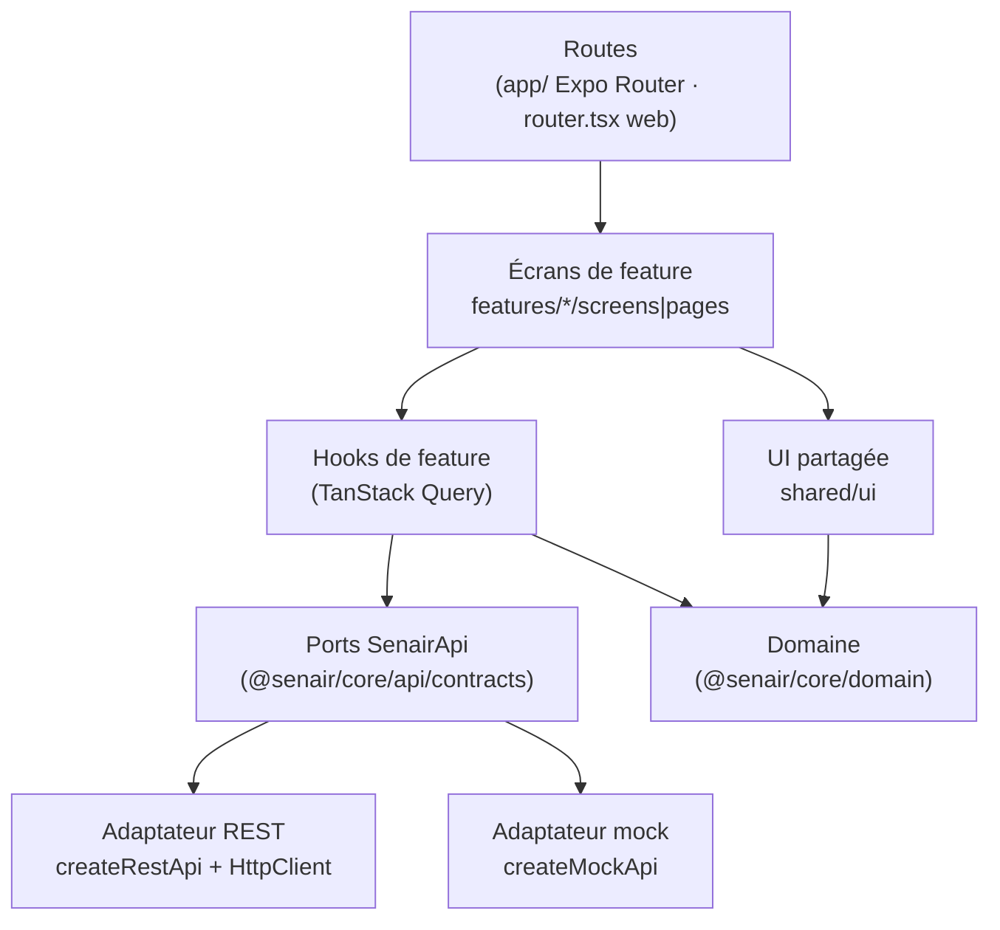
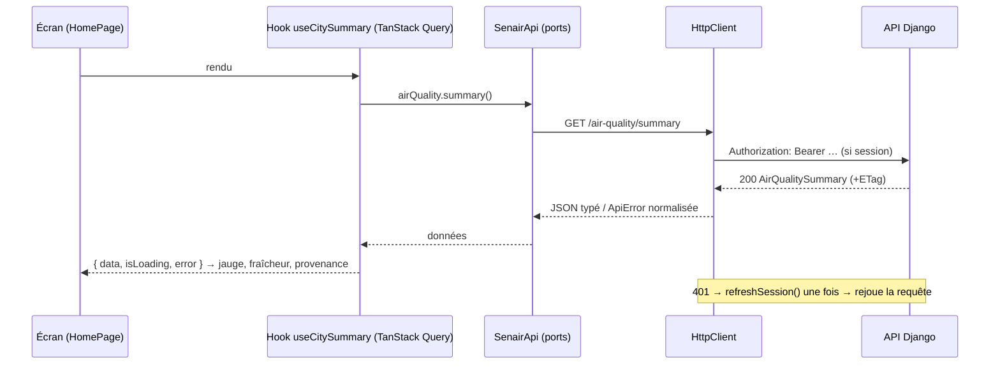

# 03. Architecture front

## 1. Vue d'ensemble du dépôt

```text
SEN-AIR/
├── package.json            workspaces npm : packages/*, senair.web, senair.mobile
├── packages/
│   └── core/               @senair/core : domaine, contrat API, client HTTP, validation, mock (aucune dépendance UI)
├── senair.web/             Vite + React 19 + TS : portail citoyen PWA + back-office /admin
├── senair.mobile/          Expo SDK 58 + Expo Router : app citoyenne iOS/Android
├── docs/                   cette documentation + api/openapi.yaml
├── .github/workflows/      intégration continue (typecheck, tests, build)
├── air_quality/            backend Django (équipe backend : hors périmètre front)
├── projet-transversal/     pipeline Kafka / modèles (équipe data : hors périmètre front)
├── Donnée/                 notebooks d'exploration
└── _archives/              sauvegarde des templates d'origine
```

```mermaid
flowchart LR
  subgraph Clients
    W[senair.web<br/>React + Vite + PWA]
    M[senair.mobile<br/>Expo / React Native]
  end
  C[(@senair/core<br/>domaine · contrat · client · mock)]
  W --> C
  M --> C
  C -- "HTTPS /api/v1 (JWT)" --> API[API Django REST]
  API --> PG[(PostgreSQL/PostGIS)]
  API --> IF[(InfluxDB)]
  API --> ML[Moteur IA / MLflow]
  K[Kafka + ETL Airflow] --> PG & IF
  S[Capteurs AirGradient<br/>OpenWeatherMap<br/>Sentinel-5P] --> K
  API -. push .-> FCM[Firebase / Expo Push] -.-> M
```

## 2. Couches et sens des dépendances



Règle : **une flèche ne remonte jamais**. Le domaine ne connaît ni React, ni HTTP ; les composants UI ne connaissent pas l'API ; les écrans ne connaissent pas le transport (REST ou mock).

| Couche | Emplacement | Responsabilité | Interdit |
|---|---|---|---|
| Domaine | `packages/core/src/domain` | niveaux IQA, polluants, référentiels de seuils, profils santé, horizons, fraîcheur, formatage | dépendances UI/réseau, état |
| Contrat | `packages/core/src/api/{types,contracts,endpoints}.ts` | DTO, ports par domaine, chemins | logique métier |
| Adaptateurs | `packages/core/src/api/{http,rest}.ts`, `src/mock/` | transport HTTP, erreurs normalisées, données de démonstration | appels depuis un composant |
| Validation | `packages/core/src/validation` | schémas zod des formulaires | |
| Autorisation UI | `packages/core/src/auth` | rôles → permissions, `hasPermission` | servir de sécurité réelle |
| Fournisseurs | `*/shared/api`, `*/features/auth` | instancier l'API, session, QueryClient | |
| Hooks de feature | `*/features/<f>/hooks` | requêtes, mutations, invalidation, clés de cache | rendu |
| UI partagée | `*/shared/ui` | composants présentatifs (jauge, badge IQA, états) | appels réseau |
| Écrans | `*/features/<f>/(screens|pages)` | composer hooks + UI, gérer les états | logique métier, `fetch` |
| Routes | `senair.mobile/app`, `senair.web/src/app/router.tsx` | URL → écran, gardes | logique |

## 3. Application des principes

### SOLID

| Principe | Application concrète |
|---|---|
| **S**, responsabilité unique | `http.ts` ne fait que le transport ; `rest.ts` ne fait que mapper opération → endpoint ; `aqi.ts` ne fait que classer ; chaque écran délègue données et rendu |
| **O**, ouvert/fermé | ajouter une source de données ou un adaptateur (ex. GraphQL, cache hors-ligne) = nouvelle implémentation de `SenairApi`, sans toucher aux écrans |
| **L**, substitution | `createMockApi()` et `createRestApi()` sont interchangeables (mêmes ports, mêmes erreurs `ApiError`) ; les tests du mock vérifient le même contrat de permissions que le serveur |
| **I**, ségrégation des interfaces | ports séparés : `ReferenceApi`, `StationsApi`, `AirQualityApi`, `ForecastsApi`, `AlertsApi`, `ArticlesApi`, `AuthApi`, `AccountApi`, `AdminApi`, un écran ne dépend que de ce qu'il utilise |
| **D**, inversion des dépendances | les écrans reçoivent `SenairApi` via un contexte (`useApi()`), choisi à la composition (`createSenairApi({ mode })`) |

### DRY

- **Une seule** fonction classe un IQA (`getAqiLevel`), **une seule** table de couleurs/libellés (`AQI_LEVELS`), **un seul** catalogue de polluants, **un seul** référentiel de seuils pédagogiques, **une seule** matrice de permissions, **une seule** liste de chemins d'API, partagés par web et mobile.
- Les schémas zod servent aux formulaires des deux apps.
- Les clés TanStack Query sont centralisées par app (`shared/api/queryKeys.ts`).

### Autres règles

- **KISS / YAGNI** : pas de store global (Redux), l'état serveur vit dans TanStack Query, l'état de session dans un contexte, le reste en local.
- **Fail visibly** : aucune valeur de repli silencieuse ; chaque donnée affiche sa fraîcheur et sa provenance.
- **Le backend fait foi** : IQA, prévisions, interpolation et autorisations sont calculés côté serveur.

## 4. Flux de données type



## 5. Choix techniques

| Besoin | Web | Mobile | Commun |
|---|---|---|---|
| Langage | TypeScript strict | TypeScript strict | TS strict, `noUncheckedIndexedAccess` |
| UI | React 19, CSS (tokens) | React Native 0.88, StyleSheet + tokens | couleurs IQA de core |
| Navigation | React Router 7 (lazy routes) | Expo Router (fichiers, typed routes) | |
| État serveur | TanStack Query 5 | TanStack Query 5 | ports `SenairApi` |
| Carte | Leaflet + react-leaflet, tuiles OSM | Leaflet dans WebView (HTML statique + `postMessage`) | `heatmap`, `stations` |
| Graphiques | Recharts | react-native-svg | `History` |
| Formulaires | zod | zod | `validation/schemas.ts` |
| Hors-ligne | Service worker Workbox (vite-plugin-pwa) | cache TanStack Query | |
| Session | jeton en mémoire + cookie httpOnly | jeton en mémoire + refresh dans SecureStore | `AuthApi` |
| Push | non (Web Push : évolution) | expo-notifications | `AccountApi.registerDevice` |
| Tests | Vitest | tsc + export Metro | Vitest (core) |

## 6. Configuration et environnements

| Variable | Web | Mobile | Valeurs |
|---|---|---|---|
| Mode d'API | `VITE_API_MODE` | `EXPO_PUBLIC_API_MODE` | `mock` (défaut) \| `rest` |
| URL de l'API | `VITE_API_BASE_URL` | `EXPO_PUBLIC_API_BASE_URL` | `http://localhost:8000/api/v1` (émulateur Android : `10.0.2.2`) |

Les variables `VITE_*` et `EXPO_PUBLIC_*` sont **publiques** (embarquées dans le bundle) : **aucun secret** n'y figure jamais.

## 7. Ajouter une fonctionnalité (recette)

1. Décrire l'endpoint dans [08-api-endpoints.md](./08-api-endpoints.md) et [api/openapi.yaml](./api/openapi.yaml).
2. Ajouter le DTO dans `core/api/types.ts`, le chemin dans `endpoints.ts`, l'opération dans le port de `contracts.ts`.
3. L'implémenter dans `rest.ts` (une ligne) **et** dans `mock/api.ts` (données de démonstration) ; ajouter un test.
4. Côté app : hook dans `features/<f>/hooks`, clé dans `queryKeys.ts`, écran, route, garde de permission si nécessaire.
5. Couvrir les états chargement / erreur / vide / hors-ligne ; vérifier mobile étroit et desktop.
