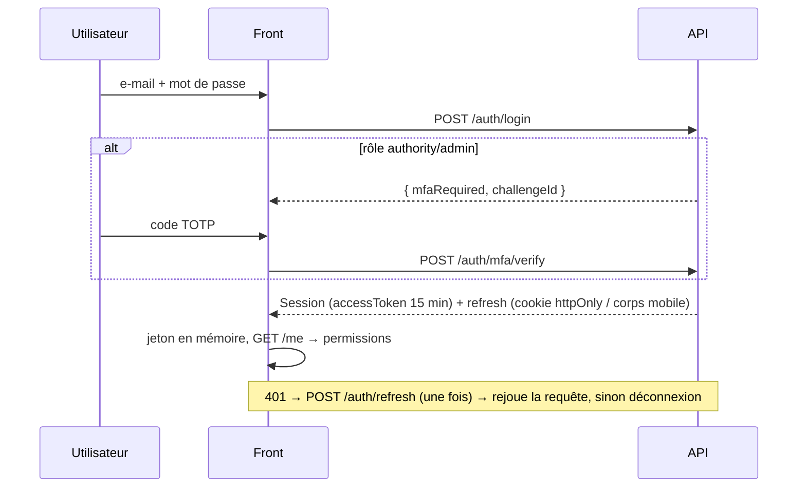

# 06. Sécurité et confidentialité

Principe directeur : **le client n'est jamais une frontière de sécurité.** Le front masque ce qui n'est pas autorisé et valide pour le confort ; le backend authentifie, autorise, valide et journalise.

## 1. Menaces et réponses

| Menace | Réponse front | Exigence backend |
|---|---|---|
| Modification des données par un anonyme (cas des templates Supabase) | aucun accès direct à la base ; écritures uniquement via `/admin/*` | permission vérifiée à chaque écriture, depuis le rôle stocké en base |
| Vol de session (XSS) | jeton d'accès **en mémoire** seulement ; refresh en cookie `HttpOnly` (web) ou trousseau SecureStore (mobile) ; pas de `localStorage` | JWT 15 min, refresh rotatif avec détection de réutilisation, révocation au logout |
| XSS via le contenu des articles | Markdown rendu **sans HTML brut** ; pas de `dangerouslySetInnerHTML` ; liens externes `noopener noreferrer` ; images HTTPS seulement | assainir le Markdown à l'enregistrement, longueur maximale |
| Injection dans la carte WebView (mobile) | HTML statique, données passées par `postMessage` + `JSON.stringify`, messages entrants validés, `originWhitelist` restreint, Leaflet chargé avec SRI | |
| CSRF sur le refresh (web) | `credentials: 'include'` uniquement vers l'API | cookie `SameSite=Strict`, vérification `Origin`, CORS à liste blanche |
| Compte admin compromis | étape MFA obligatoire dans le parcours de connexion | **MFA TOTP** pour authority/admin, verrouillage après échecs, alerte de connexion |
| Force brute / énumération | message d'échec générique | rate limiting `/auth/*`, réponse identique pour « mot de passe oublié » |
| Escalade de privilèges | gardes UI par permission ; un admin ne peut modifier son propre rôle (UI) | même règle côté serveur ; `role` jamais lu depuis le corps d'une requête d'inscription |
| Fuite d'informations par les erreurs | messages utilisateur génériques (`ApiError.userMessage`), `requestId` pour le support | pas de trace ni SQL dans les réponses |
| Données en cache sur un appareil partagé | le service worker ne met **jamais** en cache `/auth`, `/me`, `/admin` ; purge de session au logout | `Cache-Control: no-store` sur ces routes |
| Désinformation sanitaire | aucune donnée inventée ; mock signalé ; fraîcheur et provenance visibles | statut `measured/estimated/forecast` et horodatage sur chaque valeur |
| Dépendance vulnérable | `npm audit` en CI, mises à jour régulières, versions figées par le lockfile | idem |
| Secret dans le bundle | seules des variables publiques (`VITE_*`, `EXPO_PUBLIC_*`) ; `.env` ignoré par git | secrets côté serveur uniquement |

## 2. Authentification



## 3. En-têtes HTTP du web (hébergement de production)

```
Strict-Transport-Security: max-age=63072000; includeSubDomains; preload
Content-Security-Policy: default-src 'self'; script-src 'self'; style-src 'self' 'unsafe-inline';
  img-src 'self' data: https://*.tile.openstreetmap.org; connect-src 'self' https://api.senair.sn;
  font-src 'self'; frame-ancestors 'none'; base-uri 'self'; form-action 'self'
X-Content-Type-Options: nosniff
Referrer-Policy: strict-origin-when-cross-origin
Permissions-Policy: geolocation=(self), camera=(), microphone=()
Cross-Origin-Opener-Policy: same-origin
```

## 4. Données personnelles (CDC : minimisation, consentement)

| Donnée | Collecte | Base | Conservation |
|---|---|---|---|
| E-mail, nom | inscription | contrat (compte) | durée du compte |
| Zones suivies | facultatif | consentement | durée du compte |
| Profil de santé | **facultatif, case dédiée** | consentement explicite | supprimé si le consentement est retiré |
| Position GPS | ponctuelle, à la demande | consentement OS | **jamais stockée** (requête `/air-quality/at` non journalisée avec la position précise) |
| Jeton push | à l'activation des notifications | consentement OS | jusqu'à désinscription / invalidation |

L'utilisateur peut supprimer son compte depuis son espace (`DELETE /me`). Aucune donnée n'est partagée avec un tiers sans consentement. Les jeux de données publiés pour la recherche sont anonymisés.

## 5. Mobile

- Refresh token dans **expo-secure-store** (Keychain / Keystore), jamais dans AsyncStorage.
- Permissions (position, notifications) demandées **au moment de l'usage**, avec explication.
- Liens profonds `senair://` : n'ouvrent que des écrans de consultation ; aucune action sensible déclenchée par un lien.
- Builds de production sans logs de débogage.

## 6. Checklist de revue

- [ ] Aucune donnée inventée ni valeur de repli silencieuse.
- [ ] Aucune action d'écriture accessible sans permission (UI) **et** endpoint protégé côté serveur.
- [ ] Pas de `dangerouslySetInnerHTML`, pas de HTML construit par concaténation.
- [ ] Pas de jeton ni de donnée personnelle dans `localStorage`, les logs ou les URL.
- [ ] Entrées validées par zod ; erreurs serveur affichées par champ.
- [ ] Nouvelles routes sensibles exclues du cache du service worker.
- [ ] Pas de nouvelle dépendance non justifiée ; `npm audit` sans vulnérabilité critique introduite.
