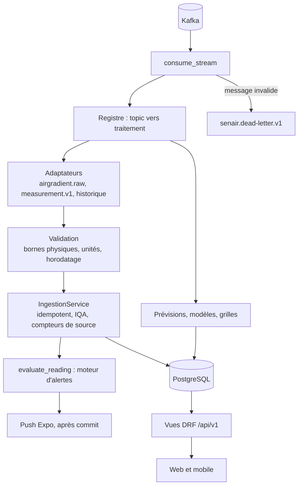

# 13. Backend : API SEN-AIR (`senair.api`)

Django 6.1 + Django REST Framework, Python 3.14. Implémente les **66 opérations** de [api/openapi.yaml](./api/openapi.yaml) et **lit en streaming** le pipeline de l'équipe data ([14-integration-donnees-ia.md](./14-integration-donnees-ia.md)).

## 1. Partage des responsabilités

| Qui | Quoi |
|---|---|
| **Backend (ce dépôt)** | API REST, comptes et MFA, stockage des mesures, calcul de l'IQA, alertes et notifications push, contenus, rapports, back-office, lecture du flux Kafka, service ou exécution des modèles |
| **Équipe IA / data** | collecte (producer AirGradient), enrichissement (OpenWeatherMap), validation, entraînement des modèles (Airflow, MLflow), publication des prévisions et des grilles |

## 2. Architecture

```text
senair.api/
├── config/                 réglages (variables d'environnement), urls, settings_test
├── senair/
│   ├── common/             camelCase, erreurs { code, message, requestId }, pagination, permissions,
│   │                       domaine (IQA, fraîcheur), fichiers CSV/PDF, téléchargements signés, seed_reference
│   ├── network/            zones, stations, sources de données
│   ├── measurements/       mesures ; ingestion/ (adaptateurs, validation, service, registre, boucle Kafka) ;
│   │                       consume_stream, import_history, publish_sample ; historiques ; exports
│   ├── forecasts/          registre des modèles IA, prévisions, grilles, fournisseurs d'interpolation (grille, KNN, IDW)
│   ├── alerts/             seuils, alertes, moteur d'évaluation, notifications push (Expo), conseils santé
│   ├── accounts/           utilisateurs, JWT + refresh rotatif, MFA TOTP, préférences, appareils
│   ├── content/            articles, médias (contrôle de signature, suppression des métadonnées EXIF)
│   └── reporting/          tableau de bord, rapports, fréquentation anonymisée, journal d'audit
└── tests/                  contrat (chaque réponse validée contre openapi.yaml), parité avec le front, par domaine
```



Principes :
- chaque application possède ses modèles et ses vues ; les règles partagées vivent dans `common` ;
- un format de message = un **adaptateur** : ajouter une source ne touche pas au reste (ouvert/fermé) ;
- les modèles d'interpolation sont des **fournisseurs interchangeables** : grille du flux, puis modèle actif, puis IDW ;
- le backend est la **source de vérité de l'IQA** ; il ne fabrique jamais de prévision.

## 3. Démarrer

### En local (SQLite)

```bash
cd senair.api
python3 -m venv .venv && .venv/bin/pip install -r requirements-dev.txt -r requirements-ml.txt
export DJANGO_DEBUG=1
.venv/bin/python manage.py migrate
.venv/bin/python manage.py seed_reference          # 9 stations, seuils OMS / NS 05-062, conseils santé, modèle KNN
.venv/bin/python manage.py import_history          # historique réel ../projet-transversal/air_quality.csv
.venv/bin/python manage.py seed_demo_content       # 20 articles, dont 15 illustrés
.venv/bin/python manage.py create_demo_users       # citoyen, autorité, admin (QR codes TOTP à scanner)
.venv/bin/python manage.py runserver               # Swagger : http://localhost:8000/api/v1/docs/
.venv/bin/python manage.py consume_stream          # second terminal : lecture du flux Kafka
```

Côté front : `VITE_API_MODE=rest` et `VITE_API_BASE_URL=http://localhost:8000/api/v1` (web), `EXPO_PUBLIC_API_MODE=rest` (mobile). Le web et l'API doivent être sur le **même site** (`localhost` et `localhost`, ou `senair.sn` et `api.senair.sn`), car le cookie de session est `SameSite=Strict`.

### Avec Docker (PostgreSQL)

```bash
cd senair.api
cp .env.example .env        # renseigner DJANGO_SECRET_KEY, FIELD_ENCRYPTION_KEY, POSTGRES_PASSWORD
docker compose up -d --build                 # db + api (migrations et référence au démarrage) + stream
docker compose --profile kafka up -d         # avec un Kafka local si le pipeline ne tourne pas
docker compose run --rm api import_history /chemin/air_quality.csv
```

Pour lire le Kafka de l'équipe data depuis un conteneur, reliez le service `stream` au réseau de leur composition et utilisez `KAFKA_BOOTSTRAP_SERVERS=kafka:9093` (leur écoute interne). Depuis l'hôte : `localhost:9092`.

## 4. Commandes

| Commande | Rôle |
|---|---|
| `seed_reference` | données de référence (idempotent) |
| `consume_stream [--max-messages N] [--timeout S] [--from-beginning]` | consommateur Kafka (groupe `senair-api`), commit après traitement, dead-letter, arrêt propre |
| `import_history [chemin] [--batch-size 500] [--skip-alerts]` | import de l'export MySQL `air_quality_data` (idempotent) |
| `publish_sample` | publie un message exemple de chaque topic (démonstration) |
| `generate_reports --period weekly\|monthly [--format pdf]` | rapports planifiés (cron ou Airflow), sans doublon |
| `create_demo_users [--reset-mfa] [--no-qr]`, `setup_mfa <email>` | comptes de démonstration (DEBUG seulement, secrets TOTP conservés), enrôlement TOTP d'un compte privilégié avec QR code dans le terminal |
| `seed_demo_content [--fixtures-only]` | 20 articles : les 5 du mode démo du front et 15 articles rédigés à partir des mesures réelles, illustrés par des photos libres (crédits dans `senair/content/seed_media/credits.json`) |

## 5. Sécurité (détail dans [06-securite.md](./06-securite.md))

- **JWT** d'accès de 15 min ; **refresh rotatif** blacklisté après usage ; la **réutilisation** d'un refresh révoque toutes les sessions de l'utilisateur.
- Web : refresh en cookie `HttpOnly; SameSite=Strict; Path=/api/v1/auth`, avec contrôle de l'`Origin`. Mobile (`X-Client: senair-mobile`) : refresh dans le corps.
- **MFA TOTP obligatoire** pour les autorités et administrateurs, secret chiffré en base (Fernet).
- Verrouillage de 15 min après 5 échecs ; message d'échec générique ; temps de réponse égalisé.
- Permissions vérifiées **côté serveur** sur chaque route, miroir exact du front (test de parité).
- **Alertes** : publiées par les mesures ou manuellement par une autorité (`POST /admin/alerts`, notification push de la zone), supprimables (`DELETE /admin/alerts/{id}`) ; côté utilisateur, lues et retirées comme des notifications (`/me/alerts/...`).
- **Audit** de toute écriture d'administration : auteur, horodatage, avant et après, IP, `requestId`.
- Médias : type réel vérifié par signature, tailles limitées, **métadonnées EXIF (GPS) supprimées** par réencodage.
- Téléchargements par **URL signée** valable 10 min ; fréquentation mesurée par hachage quotidien salé, **aucune IP stockée**.
- `Cache-Control: no-store` sur `/auth`, `/me`, `/admin` ; ETag et cache public court sur les lectures publiques.

## 6. Qualité

| Vérification | Commande | Résultat (2026-11-02) |
|---|---|---|
| Tests : contrat, parité, domaines | `.venv/bin/pytest` | 262 réussis, 1 ignoré (Kafka réel) |
| Même suite sur PostgreSQL 17 | `DATABASE_URL=postgres://… .venv/bin/pytest` | 262 réussis, 1 ignoré, en 1 min 19 |
| Kafka réel | `KAFKA_TEST_BOOTSTRAP=localhost:29092 .venv/bin/pytest -m kafka` | réussi : message brut stocké, message invalide en dead-letter |
| Bout en bout avec le client du front | `SENAIR_API_URL=… npx vitest run e2e` (dans `packages/core`) | 3 scénarios réussis |
| Navigateur, web en mode `rest` | parcours connexion et rechargement | données réelles, cookie `HttpOnly`, aucun jeton stocké, session restaurée |
| Lint | `.venv/bin/ruff check senair config tests` | aucun problème |
| Image Docker et PostgreSQL | `docker compose up -d db api` | migrations et API opérationnelles |

Chaque réponse d'API est validée contre `docs/api/openapi.yaml` par `tests/contract.py` : le contrat partagé avec le front ne peut pas dériver sans que les tests échouent.

## 7. Décisions à prendre avec l'équipe IA / data

1. **Formule de l'IQA.** Avec la valeur guide OMS (15 µg/m³), 196,6 µg/m³ de PM2.5 donne un IQA de 1 311 ; le pipeline utilise 75 µg/m³ (IQA 262). L'échelle affichée (0 à 300 et plus) suppose des limites du type cible intermédiaire. Réglable sans code par `AQI_LIMIT_PM25`, `AQI_LIMIT_PM10`, etc.
2. **Alertes d'une station muette.** Réglé : après `ALERT_GAP_HOURS` (24 h) sans confirmation, un nouveau dépassement ouvre une nouvelle alerte, et les listes publiques ne montrent que les `ALERT_HISTORY_DAYS` (30) derniers jours. Reste à décider s'il faut aussi clôturer automatiquement une alerte sans nouvelle mesure.
3. **TVOC** : 156 valeurs au-dessus de 500 dans l'historique (indice ou ppb ?), écartées en attendant.
4. **`method: knn`** : le KNN est présenté comme `idw` (pondéré par la distance) avec `modelVersion: knn-interpolation@airflow` ; ajouter `knn` au contrat si souhaité.
5. **Version de scikit-learn** : `knn_model.pkl` a été produit avec une autre version (avertissement au chargement). Fixer la même version dans Airflow et dans l'API.

## 8. Limites connues

- Pas d'antivirus ni de miniature vidéo sur les médias ; rapports générés de façon synchrone (suffisant pour 9 stations).
- Alertes par e-mail non envoyées (la préférence est enregistrée) ; reçus Expo non relevés.
- Un access token reste valide jusqu'à 15 min après une révocation ; un compte désactivé est, lui, refusé immédiatement.
