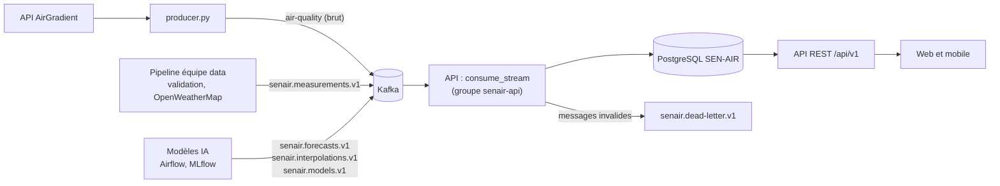

# 14. Intégration avec le pipeline de données et les modèles IA

> **Destinataires : équipe IA / data** (producer, consumer, Airflow, modèles).
> L'API SEN-AIR (`senair.api`) ne collecte rien elle-même : elle **lit vos messages Kafka**, les stocke, calcule l'IQA, déclenche les alertes et les sert au web et au mobile. Ce document décrit ce que vous publiez et ce que l'API en fait.

## 1. Vue d'ensemble



L'API utilise **son propre groupe de consommateurs** (`senair-api`) : elle lit les mêmes topics que vos consumers sans les perturber.

## 2. Ce qui fonctionne dès aujourd'hui, sans rien changer

| Votre existant | Ce que fait l'API |
|---|---|
| `producer.py` publie le JSON AirGradient brut sur `air-quality` | consommé directement (adaptateur `AirGradientRawAdapter`) : PM2.5, PM10, CO₂, COV, température, humidité |
| `projet-transversal/air_quality.csv` (export de `air_quality_data`) | importé avec `python manage.py import_history` (adaptateur `HistoryRowAdapter`) |
| `air_quality/airflow/models/knn_model.pkl` (KNN latitude, longitude) | chargé par l'API pour `GET /air-quality/at` et la carte (`/air-quality/heatmap`) |

Limite : le topic brut ne contient pas les gaz (CO, NO₂, SO₂, O₃…) ajoutés par votre `consumer.py`, qui les écrit seulement dans MySQL. Pour que l'application les affiche en temps réel, publiez le format enrichi ci-dessous.

## 3. Topics et formats à publier

Clés JSON en **camelCase**, dates **ISO-8601 UTC** (`2026-11-02T14:00:00Z`), valeur absente = `null`. Les schémas sont dans [`docs/stream/`](./stream) : validez vos messages avec eux (`jsonschema`, Draft 2020-12) avant de publier.

| Topic | Schéma | Contenu | Clé Kafka conseillée |
|---|---|---|---|
| `senair.measurements.v1` | [measurement.v1](./stream/measurement.v1.schema.json) | une mesure validée et enrichie, une station, un horodatage capteur | `stationId` |
| `senair.forecasts.v1` | [forecast.v1](./stream/forecast.v1.schema.json) | un lot de prévisions (1 h à J+3) pour la ville, une zone ou une station | `scope:scopeId` |
| `senair.interpolations.v1` | [interpolation.v1](./stream/interpolation.v1.schema.json) | une grille estimée (krigeage, Random Forest…) d'une couche | `layer` |
| `senair.models.v1` | [model.v1](./stream/model.v1.schema.json) | la déclaration d'un modèle entraîné, avec ses métriques | `id` |

### Mesure (`senair.measurements.v1`)

```json
{
  "schemaVersion": "1",
  "messageId": "6f1d4c1e-3b0a-4a51-9a51-3f4b3d1d2e10",
  "stationId": "168373",
  "stationName": "Thiès, Hôtel de Ville",
  "location": { "latitude": 14.791343, "longitude": -16.924869 },
  "observedAt": "2026-07-06T13:02:03Z",
  "status": "measured",
  "measures": {
    "pm25": { "value": 205.1, "unit": "µg/m³", "source": "sensor" },
    "pm10": { "value": 207.2, "unit": "µg/m³", "source": "sensor" },
    "co2": { "value": 349, "unit": "ppm", "source": "sensor" },
    "co": { "value": 0.0775, "unit": "mg/m³", "source": "openweathermap" },
    "o3": { "value": 59.62, "unit": "µg/m³", "source": "openweathermap" }
  },
  "weather": { "temperatureC": 34.5, "humidityPct": 52, "windSpeedMs": 7.15, "windDirectionDeg": 235, "source": "openweathermap" },
  "upstreamAqi": 273.47
}
```

Points d'attention, tirés de vos données réelles :

- **`observedAt` = horodatage du capteur** (`timestamp` AirGradient), jamais `created_at`. Une même mesure republiée est ignorée (contrainte station + horodatage). C'est ce qui permet d'afficher « Données en retard » quand une station est figée, comme l'Hôtel de Ville à 13:02:03.
- **Une valeur absente vaut `null`**, jamais `0` (les `pm10 = 0.0` actuels sont traités comme absents quand `pm25 > 0`).
- **CO en mg/m³** : OpenWeatherMap le donne en µg/m³, divisez par 1 000 (ou indiquez `"unit": "µg/m³"`, l'API convertit).
- **`source`** : `openweathermap` pour les gaz et le vent à l'échelle de la ville, `sensor` pour les capteurs. L'application l'affiche à côté de chaque valeur.
- **`messageId`** unique (UUID) : rend la consommation idempotente.

### Prévisions (`senair.forecasts.v1`)

```json
{
  "schemaVersion": "1",
  "messageId": "0b8e2f9c-58a4-4d55-8f0f-7b2b1b9a4d21",
  "model": { "id": "xgboost-forecast", "name": "Prévision IQA", "algorithm": "XGBoost", "version": "1.0.0" },
  "scope": "city",
  "scopeId": "thies",
  "generatedAt": "2026-11-02T14:00:00Z",
  "forecasts": [
    { "horizon": "1h", "validAt": "2026-11-02T15:00:00Z", "aqi": 118, "dominantPollutant": "pm25",
      "confidence": 0.92, "interval": { "low": 110, "high": 126 }, "drivers": ["Heure de pointe du trafic"] },
    { "horizon": "1d", "validAt": "2026-11-03T14:00:00Z", "aqi": 104, "confidence": 0.71,
      "interval": { "low": 88, "high": 121 }, "drivers": ["Vent de nord-est (harmattan) modéré"] }
  ]
}
```

- Horizons : `1h`, `2h`, `3h`, `1d`, `2d`, `3d` (affichés +1 h… J+3). `scope` vaut `city` (`scopeId: "thies"`), `zone` (identifiant de quartier, ex. `centre-ville`) ou `station` (ex. `168373`).
- **`confidence` et `interval` viennent de votre modèle** : l'API ne les invente jamais.
- `drivers` : facteurs explicatifs en langage clair (issus de SHAP par exemple), affichés tels quels.
- L'API sert le **dernier lot d'un modèle actif**. Sans lot, elle répond « Aucune prévision disponible pour l'instant » : elle ne fabrique pas de prévision.

### Grille d'interpolation (`senair.interpolations.v1`)

Une liste de cellules `{ latitude, longitude, value, aqi, uncertainty }` pour une couche (`aqi`, `pm25`…), avec `method` (`kriging`, `random_forest`…) et `resolutionM`. L'API utilise la grille la plus récente de moins de 2 h pour la carte et pour « IQA de ma position ». Sans grille récente, elle exécute le modèle actif s'il est chargeable (comme le KNN), sinon elle calcule une estimation IDW signalée comme telle.

### Déclaration de modèle (`senair.models.v1`)

```json
{
  "schemaVersion": "1",
  "messageId": "c1d2e3f4-0000-4000-8000-000000000001",
  "id": "xgboost-forecast",
  "name": "Prévision IQA court et moyen terme",
  "task": "forecast",
  "algorithm": "XGBoost",
  "version": "1.0.0",
  "metrics": { "r2": 0.82, "rmse": 9.4, "mae": 6.8 },
  "trainedAt": "2026-11-01T22:00:00Z",
  "trackingUrl": "http://mlflow.local/#/experiments/1/runs/abc",
  "artifactUri": null,
  "signature": { "inputs": ["..."], "outputs": ["aqi"] }
}
```

- Un nouveau modèle arrive en **`candidate`** : il n'est servi qu'après activation par un administrateur (back-office, page Modèles IA, où R², RMSE et MAE sont affichés). Activer un modèle archive l'ancien modèle actif de la même tâche.
- `artifactUri` est utile seulement si l'API doit exécuter le modèle elle-même (fichier joblib lisible, comme le KNN). Pour XGBoost et LSTM, **publiez les prévisions calculées** sur `senair.forecasts.v1` : c'est le mode recommandé, qui évite les conflits de versions de bibliothèques.

## 4. Messages refusés

Un message invalide (schéma, horodatage absent, station sans coordonnées…) est envoyé sur `senair.dead-letter.v1` avec la raison et la charge d'origine. Consultez-le dans Kafka UI. Le taux de rejet sur 24 h de chaque source est visible dans le back-office (page Sources de données).

## 5. Décision à prendre ensemble : la formule de l'IQA

Votre `consumer.py` calcule `iqr` avec 75 µg/m³ pour les PM2.5 (cible intermédiaire OMS) et 150 pour les PM10 ; la présentation du projet annonce les valeurs guides OMS 2021 (15 et 45). L'API calcule l'IQA elle-même (source de vérité de l'application), avec les limites réglables `AQI_LIMIT_*` (défaut : OMS 2021). Votre valeur est conservée dans `upstreamAqi` pour comparaison. **Choisissez une règle commune et documentez-la.**

## 6. Tester localement

```bash
cd senair.api
.venv/bin/python manage.py publish_sample                 # publie un exemple de chaque topic
.venv/bin/python manage.py consume_stream --max-messages 10 --timeout 30
```
